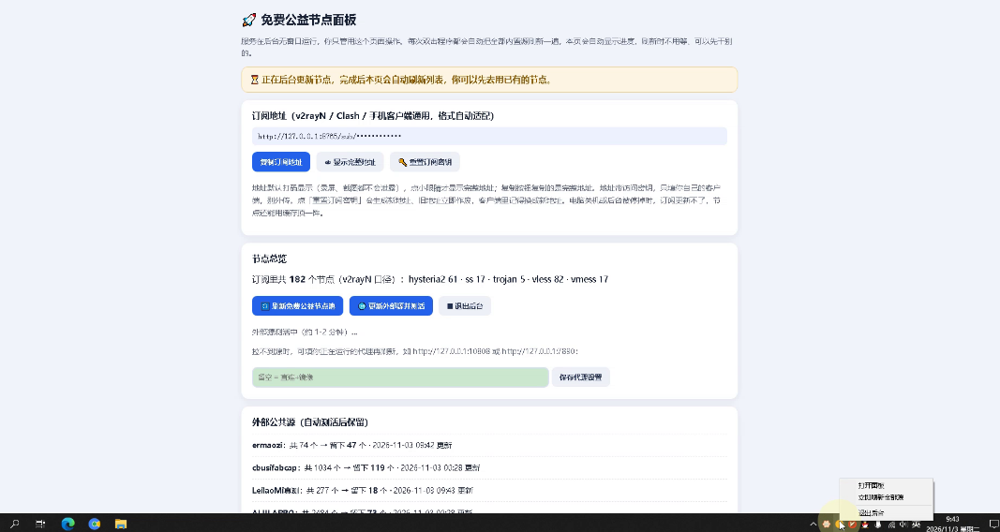

# 免费公益节点面板（FreeNodePanel）

一个为纯小白设计的 Windows / 安卓一键节点工具：**下载、打开、复制订阅**，三步搞定。

它在本地聚合多个公开免费节点源（免费公益节点池 + 5 个外部公共源 + 你自己添加的自定义源），自动测活、去重，生成一份同时兼容 **v2rayN / v2rayNG** 与 **Clash 系（Clash Verge / FlClash / mihomo）** 的订阅。没有任何安装步骤，没有黑窗口，界面就是一个自动打开的本地网页（安卓版直接在 App 里打开）。

> 📢 **本项目免费开源，仅供学习测试，严禁商用。** 任何收费分发、捆绑销售、集成进营利产品/服务、收费代部署等行为都不被允许，详见 [许可证](LICENSE)。

> 免费节点寿命普遍只有几小时到几天。本工具的思路是：**每次打开自动更新一遍**，用最新的一批，而不是指望某批节点长期可用。

## 界面预览



面板本体就是双击后自动打开的这个本地网页：订阅地址默认打码、节点总览、外部源状态一屏看完；右下角是托盘图标的右键菜单（打开面板 / 立即刷新 / 退出后台）。

## 功能特性

- **零安装、零窗口**：单个 EXE（约 8 MB），双击不弹任何控制台窗口，浏览器自动打开操作面板
- **每次启动自动更新**：内置源全部重新拉取 + 测活；后台运行时每 3 小时再自动刷新一轮
- **多源聚合**：
  - 免费公益节点池：Xray ×4 / Clash.Meta ×6 / Hysteria v1 ×4 / Hysteria2 ×4，共 18 个槽位（双链路：主站 + 镜像）
  - 外部公共源 ×5：ermaozi、cbusifabcap、LeilaoMi真测、ALIILAPRO、Au1rxx 节点池（GitHub raw → jsDelivr → 国内镜像三链路自动切换；Au1rxx 是 Clash YAML 订阅，内置解析器翻译成节点后走同一套管线）
  - **自定义源**：面板里粘贴订阅地址或链接列表即可添加，重启不丢失，和内置源走同一套测活合并流程
- **真握手测活**：TCP 系协议（vmess / vless / trojan / ss）逐个做连接 + TLS 握手（ws 还要求 101 升级成功）才保留；Hysteria 系走 UDP 无法握手测活，按上限收录后交给客户端的自动选择组
- **一份订阅，两种格式**：按客户端 User-Agent 自动分流——v2rayN 拿到 base64 链接列表，Clash / mihomo 拿到 YAML 配置（已通过 mihomo 官方内核校验）
- **订阅密钥保护**：地址默认打码显示（录屏、截图不怕泄露），点小眼睛才显示完整地址；支持一键重置密钥，旧地址立即作废
- **系统托盘图标**：绿色 = 运行中，橙色 = 正在更新，悬停显示节点数；双击打开面板，右键可刷新 / 退出
- **想停就停**：面板里有「退出后台」按钮，关掉网页不会误停后台，退出则干干净净
- **Clash 友好**：生成的配置内置本机 / 局域网直连规则；面板有「⚡ 一键导入 Clash Verge」按钮（`clash://` 唤起自动导入），还能直接下载 Clash 配置文件，Verge 在线更新抽风时可本地导入
- **延迟看得见、排在前**：测活过的节点在面板明细里带 ⚡ 毫秒数；订阅输出按延迟从低到高排序，客户端的自动选择能更快挑到快节点
- **新版本提示**：后台每天查一次 GitHub 发布页，有新版时面板顶部出现提示条，不用盯仓库
- **一键诊断**：面板可一键复制诊断信息（版本、各源状态、日志尾部，订阅密钥自动打码），提 Issue 时粘贴即可，少来回追问
- **只绑本机**：服务只监听 `127.0.0.1:8765`，不对局域网和外网开放
- **安卓版同等功能**：同一套 Go 服务跑在手机本机，App 内直接打开面板；前台服务 + 常驻通知保活（通知在 = 服务在，类比电脑版托盘图标），订阅由同机的 v2rayNG / FlClash 直接拉 `127.0.0.1`；面板的一键导入按钮在 App 里自动变成「⚡ 一键导入 FlClash」

## 快速开始（小白三步）

每次 Release 含两个资产：`FreeNodePanel-Windows.zip`（Windows 版）和 `FreeNodePanel-Android.apk`（安卓版），按设备二选一。

**Windows 版**

1. 到 [Releases](../../releases) 下载 `FreeNodePanel-Windows.zip`，解压
2. 双击 `免费公益节点面板.exe`（首次被 SmartScreen 拦截时点「更多信息 → 仍要运行」），等浏览器自动打开面板、顶部进度条走完
3. 点面板上的「复制订阅地址」：
   - **v2rayN**：订阅分组 → 添加订阅 → 粘贴 → 更新订阅
   - **Clash Verge**：订阅页粘贴地址导入；若更新报错，先看下面常见问题，或改用面板的「⬇ 下载 Clash 配置文件」本地导入

> 升级：把新 EXE 放回**同一个文件夹**覆盖即可，`data/` 里的订阅密钥和自定义源会保留，客户端不用改任何设置。

**安卓版**（需 arm64 机型，绝大多数近年安卓手机都是）

1. 到 [Releases](../../releases) 下载 `FreeNodePanel-Android.apk` 传到手机，点开安装（系统问「安装未知应用」时选允许）
2. 打开 App：服务会在手机本机启动，通知栏出现划不掉的常驻通知（在 = 服务运行中），App 里直接就是面板，等节点刷新出数
3. 导入订阅，二选一：
   - **FlClash**：点面板订阅卡上的「⚡ 一键导入 FlClash」，跳进 FlClash 确认导入即可
   - **v2rayNG**：复制面板订阅地址 → v2rayNG 的订阅分组设置里粘贴 → 更新订阅
   - 更新订阅前先确认常驻通知还在（服务被系统杀掉时订阅会拉失败，重新打开 App 即可）；首次打开弹的「允许后台运行」提示建议点允许，订阅更稳

> 升级：正式版之间升级，新版 APK 直接点开覆盖安装即可，订阅密钥和数据都保留，客户端不用改设置。
>
> ⚠️ **从 v0.1.x 原型版（测试包）升级到正式版是例外**：正式版换用了正式发布签名，与原型版的测试签名不同，安卓不允许不同签名覆盖安装——请**先卸载原型版、再装正式版**（仅此一次，以后正式版之间都能直接覆盖）。卸载会清掉原型版数据，装好正式版后到面板**重新复制一次订阅地址**到 FlClash / v2rayNG 即可。

## 从源码构建

需要 Go 1.23 或更高版本，无其他依赖（仅 `gopkg.in/yaml.v3`）。

```powershell
# Windows（或直接双击 build.bat）
$env:CGO_ENABLED = "0"
go build -trimpath -ldflags "-s -w -H windowsgui" -o "免费公益节点面板.exe" .
```

```bash
# Linux / macOS 交叉构建 Windows 版（或直接 ./build.sh）
CGO_ENABLED=0 GOOS=windows GOARCH=amd64 \
  go build -trimpath -ldflags "-s -w -H windowsgui" -o "免费公益节点面板.exe" .
```

直接 `go run .` 也可以在本机调试运行（非 Windows 平台没有托盘，其余功能一致）。

### 安卓 APK

需要 JDK 17、Android SDK（build-tools + platform）和 Go，然后：

```bash
cd android-app && ./build.sh
# 产物：android-app/build/FreeNodePanel-android.apk
```

打包是纯 build-tools 手工管线（aapt2 / javac / d8 / apksigner），无 Gradle 依赖。工具链按环境变量定位（`JAVA_HOME`、`ANDROID_SDK_ROOT` / `ANDROID_HOME`、`GOROOT` 或 PATH），GitHub Actions 的 Release 流水线也是走同一脚本构建 APK 的。

> 说明：正式版 APK 的签名钥匙**不在仓库里**。本地构建请通过环境变量提供（`KEYSTORE_FILE`、`KEYSTORE_PASS`、`KEY_PASS`、`KEY_ALIAS`，见 `build.sh` 注释）；Release 流水线从仓库 Secrets 解码钥匙、在 runner 临时目录里签名，密码全程不回显。这样每次发布构建出的 APK 签名一致，升级时才能直接覆盖安装、不丢订阅数据。

## 工作原理

- 同一个 EXE 有两种形态：无参数双击 = 启动器（拉起后台、触发全量更新、打开面板后自行退出）；带 `--serve` = 后台服务本体（无窗口、带托盘图标）
- 后台启动时和每 3 小时：拉取节点池 18 个槽位配置并解析；并行下载外部源与自定义源的原始链接（每源最多送测 800 条），TCP 系逐个握手测活后按延迟保留（每类上限：TCP 120 / Hysteria v1 20 / Hysteria2 60），跨源去重后合并
- 订阅入口 `http://127.0.0.1:8765/sub/<密钥>`，密钥保存在 `data/sub.json`，面板可重置；不带密钥一律 403
- 全部数据只落在 EXE 旁边的 `data/`：节点缓存、`sub.json`（密钥）、`custom_sources.json`（自定义源）、`server.log`（日志）

## 数据来源与致谢

本项目是独立重写的实现（Go），节点数据全部来自以下公开项目，感谢各位维护者：

- **[bannedbook/fanqiang](https://github.com/bannedbook/fanqiang)** —— 免费节点池本体，槽位配置由其更新仓库（gitlab.com/free9999/ipupdate）维护
- **[ermaozi/get_subscribe](https://github.com/ermaozi/get_subscribe)** —— 外部源，每日自动更新
- **[cbusifabcap/daily_free_vpn](https://github.com/cbusifabcap/daily_free_vpn)** —— 外部源，每天多次更新，Hysteria2 的主力来源
- **[LeilaoMi/AutoMergePublicNodes-Optimized](https://github.com/LeilaoMi/AutoMergePublicNodes-Optimized)** —— 外部源，每 6 小时用 sing-box 真测 + 国内探针验证，量少质高
- **[ALIILAPRO/v2rayNG-Config](https://github.com/ALIILAPRO/v2rayNG-Config)** —— 外部源，每日更新的大池，TCP 系存活率最高
- **[Au1rxx/free-vpn-subscriptions](https://github.com/Au1rxx/free-vpn-subscriptions)** —— 外部源，聚合多来源并经其管线验证后导出的全量池（Clash YAML 格式，本工具内置解析接入）

界面与流程的灵感来自 [AndyWork952/chromego-panel](https://github.com/AndyWork952/chromego-panel)，本项目与其无代码隶属关系。

## 使用公共节点的注意事项

- 不要用公共节点登录重要账号（银行、支付、主邮箱、社交主号），不要传输敏感文件；节点运营者理论上能看到未加密的流量
- 遇到证书警告不要点「继续访问」；警惕节点推送的广告、假更新和假下载提示
- 重要账号开启两步验证；公共节点和付费/自建服务分开放在不同订阅里，不要混用
- 重要场合（会议、考试、支付）请预备可靠的自有服务，公共节点只适合临时、轻量用途
- 请遵守所在地法律法规，以及公司 / 学校网络的管理规定

## 常见问题

**v2rayN 里很多节点测出来是 -1？**
正常。面板测活只是粗筛（能连接、能握手），v2rayN 的真实延迟测试走完整协议栈严格得多；再加上节点自然过期，一批里真正好用的通常就十几个。用法：更新订阅时勾选「移除现存服务器」，测速后按延迟排序，删掉 -1 的用前面的。

**Clash Verge 更新订阅报 502 / 拉取失败？**
十有八九是 Verge 里存的订阅地址已过期：如果你重置过密钥、或把 EXE 换到新文件夹运行过（会生成新密钥），旧地址会被面板拒绝（403），而 Verge 会把这个失败包装成代理 502 显示。把面板当前地址重新复制粘贴到 Verge 即可；面板地址可在浏览器打开验证——显示乱码文本 = 地址有效，显示「订阅地址无效」= 需要换新地址。实在不行，用面板的「下载 Clash 配置文件」本地导入。

**关掉面板网页，订阅还能更新吗？**
能。网页只是遥控器，后台独立运行并每 3 小时自刷新。彻底停止用面板的「退出后台」按钮、托盘右键菜单或 `停止后台.bat`。电脑关机 / 重启后后台不会自启，重新双击 EXE 即可。

**手机能用吗？**
能，用安卓版：从 Releases 下载 `FreeNodePanel-Android.apk` 装到手机上，服务和电脑版一样跑在手机本机（`127.0.0.1` 是每台设备各自的本机地址，所以电脑的订阅地址没法直接给手机用，必须在手机上跑一份）。步骤见上面「快速开始 · 安卓版」。

**杀毒软件 / SmartScreen 报警？**
本程序未购买代码签名证书，未签名的单文件程序首次运行出现 SmartScreen 提示是普遍现象。介意的话可以从源码自行构建，代码全部在本仓库。

## 免责声明

本项目仅供学习与技术研究。节点内容均来自上述公开网络渠道，本项目不生产、不存储、不控制任何节点，不对其可用性、速度与安全性作任何担保。使用本项目请遵守您所在地区的法律法规，由此产生的一切后果由使用者自行承担。

## 许可证

本项目采用 [FreeNodePanel 非商业使用许可证](LICENSE)：**免费开源，仅供学习、研究与个人测试，严禁任何商业用途**——包括收费分发、捆绑/预装进收费产品或营利服务、集成进商业解决方案、以及收费提供部署/托管/运维服务。非商业再分发须保留许可证全文与本限制。

节点数据的权利归各数据来源项目所有，与本许可证无关。
